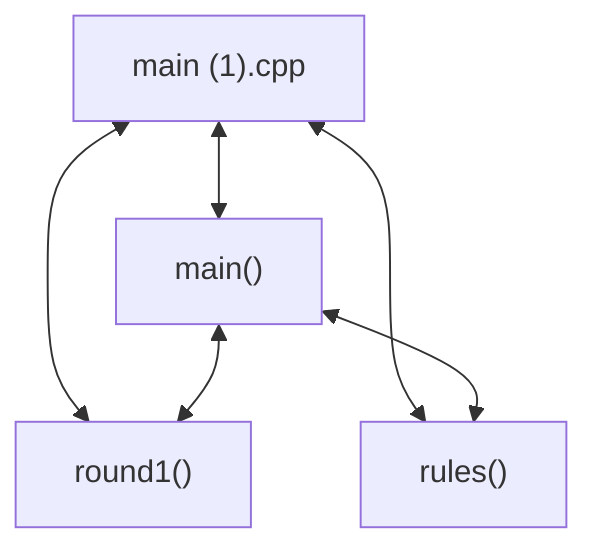

# Codebase Architectural Report

> **Auto-generated** by graphify knowledge graph analysis  
> **Purpose**: Dependency map, connection analysis, subsystem breakdown, and quality hotspots.

---

## 1. Executive Summary

- **Total Components**: `4`
- **Total Connections**: `5`
- **Subsystem Modules**: `1`
- **Dependency Types**: `2`

**Key Architectural Hubs:**

| # | Component | File | Type | Connections |
|---|-----------|------|------|-------------|
| 1 | `main (1).cpp` | `main (1).cpp` | method | 3 |
| 2 | `main()` | `main (1).cpp` | method | 3 |
| 3 | `round1()` | `main (1).cpp` | method | 2 |
| 4 | `rules()` | `main (1).cpp` | method | 2 |

---

## 2. Dependency & Connection Analysis

### Relationship Types

| Relationship | Count | Share |
|-------------|-------|-------|
| `contains` | 3 | 60% |
| `calls` | 2 | 40% |

### Hub Dependency Diagram

### Most Connected Pairs

| Component A | Component B | Shared Connections |
|-------------|-------------|-------------------|
| `main (1).cpp` | `main()` | 1 |
| `main (1).cpp` | `round1()` | 1 |
| `main (1).cpp` | `rules()` | 1 |
| `main()` | `round1()` | 1 |
| `main()` | `rules()` | 1 |

---

## 3. Subsystem & Module Breakdown

### 3.1 main (1).cpp
**Nodes**: `4`  
**Files**: `main (1).cpp`

| Component | Type | File | Connections |
|-----------|------|------|-------------|
| `main (1).cpp` | method | `main (1).cpp` | 3 |
| `main()` | method | `main (1).cpp` | 3 |
| `round1()` | method | `main (1).cpp` | 2 |
| `rules()` | method | `main (1).cpp` | 2 |

---

## 4. API Reference

Public classes and functions by subsystem.

---

## 5. Code Quality & Architectural Risk Hotspots

### Component Type Distribution

| Type | Count | Share |
|------|-------|-------|
| method | 4 | 100% |

### Dependency Cycles

**2** circular dependency loop(s) detected:

| # | Cycle Path |
|---|-----------|
| 1 | `main_1 → main_1_main → main_1_rules` |
| 2 | `main_1 → main_1_round1 → main_1_main` |

### Orphaned Components

No orphaned components detected.

---

## 6. How to Navigate

1. **Interactive D3 Map** — open `graph.html` to explore node connections visually.
2. **Knowledge Graph Queries** — use MCP tools (`graph_query`, `graph_explain_node`, `graph_impact_radius`).
